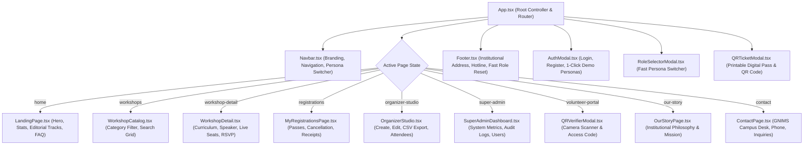
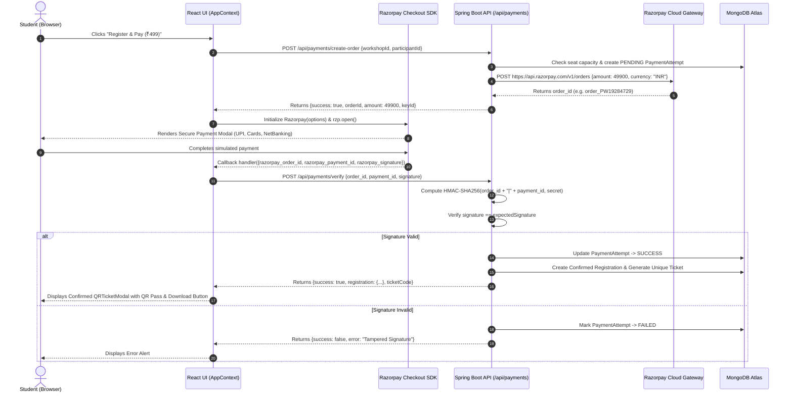

# KAUSHALYA (कौशल्य) — STUDENT 2 COMPREHENSIVE TECHNICAL REPORT
## Focus Area: User Interface (UI/UX) Development & Payment Gateway Integration
**Guru Nanak Institute of Management Studies (GNIMS), Mumbai**  
**Department of Master of Computer Applications (MCA)**  
**Academic Year:** 2026–2027  

---

## 1. Executive Summary & Student 2 Individual Ownership Scope

### 1.1 Individual Role & Assignment
In the five-member project architecture of **Kaushalya**, **Student 2** is primarily responsible for:
1. **Frontend Architecture & Engineering:** Designing, implementing, and optimizing the complete User Interface (UI) and User Experience (UX) across desktop, tablet, and mobile breakpoints using **React 19**, **TypeScript**, and **Tailwind CSS v4**.
2. **Design System & Typography:** Creating an editorial, high-trust visual language utilizing an Ivory & Forest Green brand palette, typographic hierarchy (Instrument Serif / Space Grotesk / Manrope / Plus Jakarta Sans), and responsive layout components.
3. **Payment Gateway Integration:** Architecting and implementing the end-to-end **Razorpay Checkout SDK** integration, handling order initiation, modal lifecycle, webhook sync, and client-side cryptographic signature submission for verification.
4. **Client-Server State Synchronization:** Managing real-time application state with React Context API (`AppContext.tsx`), handling JWT authentication persistence in `localStorage`, and abstracting API calls with custom fetch wrappers.

Even though responsibilities are specialized, Student 2 maintains an end-to-end understanding of the entire system, including the Spring Boot Java backend, MongoDB Atlas data layer, and Docker/Cloud deployment workflows.

---

## 2. Complete Project Overview: What is Kaushalya?

### 2.1 The Academic Problem
Colleges and universities host dozens of specialized technical workshops, lab bootcamps, and hackathons every semester. However, academic departments historically struggle with:
* **Fragmented Spreadsheets:** Student registrations collected via Google Forms without real-time seat tracking.
* **Fire Code & Room Capacity Violations:** Overcrowding caused by manual sign-ins and unverified walk-ins.
* **Gate Check-in Bottlenecks:** Volunteers manually checking printed roll lists with pens, leading to 30–45 minute queues.
* **Ticket Counterfeiting:** Screenshot sharing of confirmation emails.
* **Payment Reconciliation Chaos:** Cash collection or manual UPI screenshot verification without instant automated ticketing.

### 2.2 The Kaushalya Solution
**Kaushalya (कौशल्य)** is an enterprise-grade, academic-first workshop capacity governance and digital ticketing platform. It provides:
1. **Dynamic Capacity Governance:** Prevents overbooking with atomic seat reservation holds.
2. **Tiered Pricing & Instant Checkout:** Supports 100% free community sessions (1-click RSVP) alongside paid masterclasses powered by **Razorpay Test Mode** checkout.
3. **Cryptographic QR Ticketing:** Issues non-forgeable, tamper-evident digital QR passes with embedded timestamps and participant signatures.
4. **Live Gate Verification:** A high-speed web camera QR scanner for student volunteers that checks in attendees in under 200ms with offline duplicate RSVP prevention.
5. **Role-Based Workspaces:** Tailored dashboards for Students, Faculty Organizers, Gate Volunteers, and Campus Super Administrators.

---

## 3. UI/UX Architecture & Frontend Stack

### 3.1 Technology Stack & Justification

| Technology | Version | Purpose in Kaushalya |
|---|---|---|
| **React** | `19.0.1` | Component-based reactive UI library; utilizes hooks (`useState`, `useEffect`, `useCallback`, `useMemo`) for instant UI re-renders without full-page reloads. |
| **TypeScript** | `7.0.2` | Strong static typing for domain models (`Workshop`, `Registration`, `User`), compile-time safety, and autocomplete across UI forms. |
| **Tailwind CSS** | `4.3.3` | Utility-first CSS framework providing responsive grid layouts, custom brand color tokens, dark mode classes, and zero CSS bundle bloat. |
| **Motion (Framer Motion)** | `12.23.24` | Fluid UI transitions, modal entrance/exit animations, accordion physics, and drawer gestures. |
| **Lucide React** | `0.546.0` | Accessible, consistent SVG icon set communicating interface controls (tickets, calendars, scanners, locks). |
| **Vite** | `8.3.5` | Next-generation frontend build tool with sub-millisecond Hot Module Replacement (HMR) and optimized Rollup production bundling. |

### 3.2 Visual Design System & Brand Palette

Student 2 engineered an editorial academic aesthetic replacing generic bootstrap templates:

```
┌─────────────────────────────────────────────────────────────┐
│                      BRAND COLOR PALETTE                    │
├──────────────────┬─────────────────┬────────────────────────┤
│ Color Name       │ Hex Code        │ Semantic Purpose       │
├──────────────────┼─────────────────┼────────────────────────┤
│ Forest Green     │ #08482D         │ Primary Brand Accent   │
│ Forest Hover     │ #0C5C3B         │ Button Hover State     │
│ Sage / Ivory Tint│ #DAE7C7         │ Badges & Subtle Pills  │
│ Ivory Background │ #F5F8EF         │ Light Mode Page Canvas │
│ Dark Mode Canvas │ #101B14         │ Deep Forest Night Base │
│ Dark Mode Card   │ #16281D         │ Elevated Dark Surface  │
│ Border Rule      │ #DCE4D6         │ Crisp Clean Dividers   │
│ Ink Black        │ #101410         │ High-Contrast Headline │
└──────────────────┴─────────────────┴────────────────────────┘
```

### 3.3 Component Hierarchy & Screen Flow



### 3.4 Mobile Responsiveness & Accessibility Engineering
Student 2 ensured seamless mobile operation on all smartphones (360px – 430px viewport widths):
* **No Horizontal Overflow:** Strict application of `max-w-full`, `overflow-x-hidden`, and responsive padding (`px-4 sm:px-6 lg:px-8`).
* **Slide-over Mobile Drawer:** The desktop navigation collapses into a responsive slide-over drawer on screens `< 1024px`, featuring full GNIMS branding, quick switch links, and an accessible backdrop dismiss.
* **Touch-Friendly Hit Targets:** All interactive buttons and inputs maintain a minimum touch bounding box of 44×44 CSS pixels.
* **Dynamic Viewport Units:** Uses `dvh` (Dynamic Viewport Height) for modals to prevent mobile browser URL address bars from cutting off modal actions.

---

## 4. Payment Gateway Integration: Razorpay Test Mode

Student 2 engineered the complete payment processing lifecycle for paid masterclasses.

### 4.1 Payment Architecture & Lifecycle Sequence



### 4.2 Frontend Code Implementation

#### Dynamic SDK Injection (`src/utils/razorpay.ts`)
```typescript
export function loadRazorpayScript(): Promise<boolean> {
  return new Promise((resolve) => {
    if (typeof window !== 'undefined' && (window as any).Razorpay) {
      resolve(true);
      return;
    }
    const script = document.createElement('script');
    script.src = 'https://checkout.razorpay.com/v1/checkout.js';
    script.async = true;
    script.onload = () => resolve(true);
    script.onerror = () => resolve(false);
    document.body.appendChild(script);
  });
}
```

#### Modal Checkout Handler (`src/context/AppContext.tsx`)
```typescript
// 1. Create order on Spring Boot backend
const orderRes = await apiFetch('/api/payments/create-order', {
  method: 'POST',
  body: JSON.stringify({ workshopId, participantId: currentUser?.id })
});
const orderData = await orderRes.json();

// 2. Load SDK dynamically
await loadRazorpayScript();

// 3. Configure Checkout Options
const options: RazorpayOptions = {
  key: orderData.keyId,
  amount: orderData.amount, // in paise
  currency: 'INR',
  name: 'Kaushalya Workshops',
  description: `${workshop.title} (Test Mode)`,
  order_id: orderData.orderId,
  prefill: {
    name: currentUser.fullName,
    email: currentUser.email,
    contact: currentUser.phoneNumber
  },
  theme: { color: '#08482D' },
  handler: async (response) => {
    // 4. Submit cryptographic response back to backend
    const verifyRes = await apiFetch('/api/payments/verify', {
      method: 'POST',
      body: JSON.stringify({
        paymentAttemptId: orderData.paymentAttemptId,
        razorpay_order_id: response.razorpay_order_id,
        razorpay_payment_id: response.razorpay_payment_id,
        razorpay_signature: response.razorpay_signature
      })
    });
    const verifyData = await verifyRes.json();
    if (verifyData.success) {
      // Show verified QR Pass
      setSelectedTicketRegistration(verifyData.registration);
      setShowTicketModal(true);
    }
  }
};
const rzp = new (window as any).Razorpay(options);
rzp.open();
```

---

## 5. How Frontend Communicates with the Spring Boot Backend

### 5.1 Communication Protocols & API Standards
All communication is structured over **HTTPS/HTTP RESTful JSON**:
* Standard HTTP verbs: `GET` (fetch), `POST` (create), `PUT` (full update), `PATCH` (status toggle), `DELETE` (cancel).
* **JWT Bearer Token Authentication:** Upon login, the Spring Boot backend issues a signed JSON Web Token. The frontend stores this token in `localStorage` under `wh_jwt_token`.
* **Centralized API Fetch Utility (`src/utils/api.ts`):** Automatically intercepts outgoing calls and appends the header:
  `Authorization: Bearer <token>`

### 5.2 Reverse Proxy & Cloud Host Routing
* **Local Development:** Vite acts as a reverse proxy. Any request to `http://localhost:3000/api/*` is transparently forwarded to `http://localhost:8080/api/*`, eliminating Cross-Origin Resource Sharing (CORS) preflight friction during local testing.
* **Production Deployment:**
  * When deployed together in Docker (Render), the built React `dist/` is served directly by Spring Boot Tomcat from `classpath:/static/`.
  * When deployed across separate hosts (e.g. Vercel for frontend and Render for backend), `src/utils/api.ts` reads `VITE_API_BASE` (`https://kaushalya-oauu.onrender.com`), and Spring Boot's `CorsConfig.java` permits cross-origin API calls with credentials.

---

## 6. How Spring Boot & Java 17 Run in the Backend (Student 2 Perspective)

Even though Student 2 leads UI & Payments, understanding the backend runtime is essential for end-to-end debugging:

1. **Java 17 LTS Runtime:** Utilizes modern Java features such as record patterns, enhanced switch expressions, and the `java.net.http.HttpClient` library.
2. **Spring Boot 3.3.x Framework:**
   * **Embedded Tomcat Server:** Runs on port `8080` without requiring external application server installations (like standalone WildFly or external Tomcat).
   * **Spring MVC Controllers (`@RestController`):** Map incoming requests (e.g., `PaymentRestController`, `WorkshopRestController`, `AuthRestController`) to service logic.
   * **Spring Data MongoDB:** Connects domain entity models (`@Document`) directly to MongoDB Atlas collections via Spring repositories (`MongoRepository<T, ID>`).
   * **Cryptographic Verification (`RazorpayService.java`):** Computes HMAC-SHA256 digests using Java's built-in `javax.crypto.Mac` and `javax.crypto.spec.SecretKeySpec` to ensure the payment signature received from the frontend has not been tampered with.

---

## 7. How MongoDB Atlas Cloud Database is Utilized

1. **Cloud Hosted Cluster:** Connected via secure SRV URI (`mongodb+srv://...`) using TLS/SSL encryption in transit.
2. **Key Collections:**
   * `users`: Stores participant profiles, hashed passwords (BCrypt), and roles (`PARTICIPANT`, `ORGANIZER`, `SUPER_ADMIN`).
   * `workshops`: Stores workshop titles, descriptions, categories, GPS venue coordinates, seat limits, and pricing mode (`FREE` vs `PAID`).
   * `registrations`: Stores confirmed seats, payment status, Razorpay IDs, and the generated unique `ticketCode`.
   * `payment_attempts`: Maintains an audit trail of every checkout attempt (`PENDING`, `SUCCESS`, `FAILED`) to prevent double-spending.
   * `audit_logs`: Records tamper-evident administrative events for university compliance.

---

## 8. Student 2 Viva Voce & Technical Defense Q&A

This section prepares Student 2 to defend their implementation during external project examination:

### Q1: Why did you choose React 19 and Vite instead of traditional multi-page JSP?
> **Answer:** "Traditional JSPs require full-page reloads for every filter or registration click, creating high server load and a clunky user experience. With React 19 and Vite, we created a reactive Single Page Application (SPA). Modals open instantly, filter changes update in real time without screen flicker, and the build produces optimized static chunks with sub-second HMR during development."

### Q2: What security measures prevent a user from faking a successful Razorpay payment?
> **Answer:** "We never trust the frontend response alone. While the browser receives `razorpay_payment_id` and `razorpay_signature` from Razorpay Checkout, registration is not confirmed until that signature is sent to our Spring Boot backend. Our backend recalculates `HMAC_SHA256(order_id + '|' + payment_id, secret)` using the server-side secret key that is never exposed to the client. Only when both binary hashes match using `MessageDigest.isEqual()` does the database mark the seat confirmed."

### Q3: Why is `amount` passed in paise instead of rupees in the Razorpay integration?
> **Answer:** "Financial transaction standards mandate integer representation of currencies to avoid IEEE 754 floating-point rounding errors (e.g. `0.1 + 0.2 = 0.30000000000000004`). In Razorpay, ₹499 is represented strictly as `49900` integer paise."

### Q4: How does your UI handle dark mode and prevent flash of unstyled content (FOUC)?
> **Answer:** "We use an inline blocking script inside `index.html` that reads `localStorage.getItem('wh_theme')` before the DOM renders. If dark mode is selected, it immediately adds the `dark` class to `document.documentElement`. Tailwind CSS v4 variables then instantly skin the page with our dark palette, preventing any white flicker."

### Q5: How do you handle mobile responsiveness for complex data views like QR passes and registration tables?
> **Answer:** "We use mobile-first responsive utility classes. On desktop, registrations display in a multi-column flex table; on mobile screens, they automatically morph into stacked individual card components with thumb-friendly buttons and collapsible details."

---

*Report prepared and defended by Student 2 (UI & Payment Gateway Lead), Guru Nanak Institute of Management Studies (GNIMS).*
