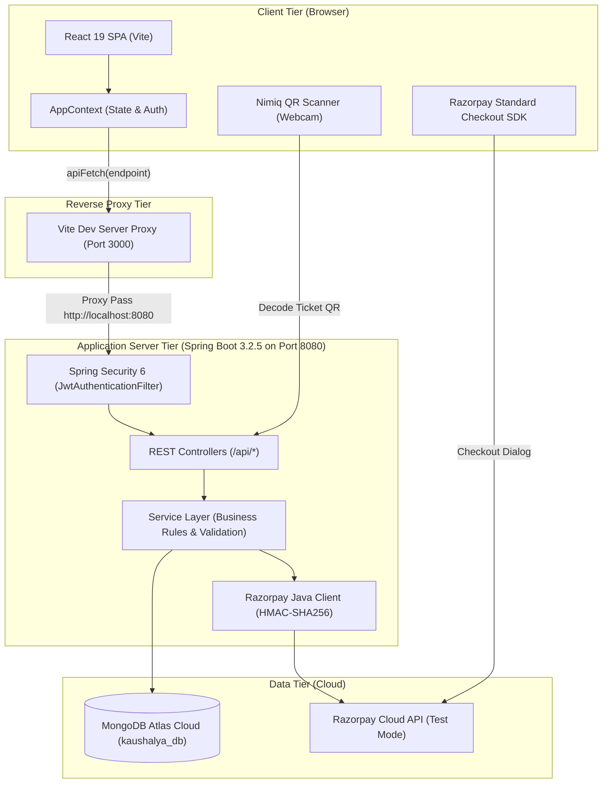

# System Architecture & Technical Specifications — Kaushalya (कौशल्य)

This document describes the architectural principles, component interactions, security model, and data flows of the Kaushalya academic workshop platform.

---

## 1. High-Level System Architecture



---

## 2. Authentication & Authorization Flow

Kaushalya utilizes a stateless, manual email and password authentication model powered by Spring Security 6, JJWT, and BCrypt:

1. **Registration (`POST /api/auth/register`)**:
   - The user inputs `fullName`, `email`, `password`, `role`, and optional `department`.
   - The backend validates the email uniqueness against MongoDB Atlas.
   - The password is salted and hashed using `BCryptPasswordEncoder`.
   - A MongoDB `User` document is created, and an `AuditLog` entry is persisted.
   - An HMAC-SHA256 JWT bearer token containing the user ID, email, and role is returned.

2. **Login (`POST /api/auth/login`)**:
   - The user provides email and password.
   - The backend checks user existence and account status (active vs suspended).
   - Password match is validated via `passwordEncoder.matches(raw, hash)`.
   - A freshly signed JWT token is issued and stored in `localStorage.setItem('wh_token', token)`.

3. **Subsequent API Requests**:
   - Every outgoing request through `src/utils/api.ts` attaches `Authorization: Bearer <token>`.
   - `JwtAuthenticationFilter` validates the signature, extracts claims, and populates `SecurityContextHolder`.

---

## 3. Free vs. Paid Workshop Registration Flow

```mermaid
sequenceDiagram
    autonumber
    actor Participant as Student Participant
    participant Frontend as React Client (Vite)
    participant Backend as Spring Boot API
    participant Razorpay as Razorpay Gateway (Test)
    participant Database as MongoDB Atlas

    alt Free Workshop (Price = 0)
        Participant->>Frontend: Click "Confirm Free Registration"
        Frontend->>Backend: POST /api/registrations (workshopId, free)
        Backend->>Database: Check capacity & duplicate active bookings
        Backend->>Database: Decrement available seats & create Registration (CONFIRMED)
        Backend-->>Frontend: 200 OK + Registration with TicketCode
        Frontend-->>Participant: Display single-use QR ticket pass
    else Paid Workshop (Price > 0)
        Participant->>Frontend: Click "Proceed to Pay ₹X"
        Frontend->>Backend: POST /api/payments/create-order (workshopId)
        Backend->>Database: Check capacity & create 15-min seat hold (PENDING_PAYMENT)
        Backend->>Razorpay: orders.create({amount, currency: INR})
        Razorpay-->>Backend: order_id
        Backend-->>Frontend: {orderId, amount, currency, keyId}
        Frontend->>Razorpay: Open Razorpay Modal (options)
        Participant->>Razorpay: Complete payment (Test card / UPI)
        Razorpay-->>Frontend: {razorpay_payment_id, razorpay_order_id, razorpay_signature}
        Frontend->>Backend: POST /api/payments/verify
        Backend->>Backend: Verify HMAC-SHA256 signature
        Backend->>Database: Update status to CONFIRMED & generate TicketCode
        Backend-->>Frontend: 200 OK + Verified Registration
        Frontend-->>Participant: Display verified QR ticket pass
    end
```

---

## 4. Gate Volunteer & Ticket Verification Architecture

1. **Delegation**:
   - Organizers create volunteer assignments in Organizer Studio (`POST /api/volunteers`).
   - The backend generates a secure 6-digit access code (e.g. `VOL-782190` or `VOL-DEMO1`).

2. **Gate Station Access**:
   - The appointed volunteer navigates to `/volunteer-portal`.
   - Logging in with the access code establishes an authenticated volunteer station locked to their assigned workshop.

3. **High-Speed Camera QR Verification**:
   - The client runs a continuous 25 FPS video stream using the `@nimiq/qr-scanner` worker.
   - A visual laser sweep reticle guides the volunteer to point the camera at the attendee's phone or paper ticket.
   - Upon decoding a ticket code, `POST /api/volunteers/verify-ticket` checks:
     - Is the ticket valid and matching the current workshop?
     - Has the ticket already been used? (Duplicate detection).
     - Is the workshop scheduled for today? (With organizer date-bypass toggle for rehearsals).
   - An instant dual-tone Web Audio synthesizer chime plays:
     - Ascending chime (800Hz → 1200Hz): Verification success.
     - Descending buzzer (300Hz → 200Hz): Warning / Duplicate ticket.
   - Attendance is marked live, and the organizer's roster updates in real time.

---

## 5. Theme System Architecture

1. **Light Mode Default**:
   - `index.html` inline script runs before DOM rendering: reads `localStorage.getItem('wh_theme')`.
   - If `saved === 'dark'`, it applies `.dark` to `document.documentElement`.
   - For all first-time visitors (`saved === null`), it guarantees light mode without OS preference override.
   - `AppContext.tsx` maintains the single source of truth and writes changes to `localStorage`.

2. **Color Palette & CSS Custom Properties**:
   - **Canvas Light**: Warm off-white `#F5F8EF` with deep forest green `#08482D` and mint `#DAE7C7`.
   - **Canvas Dark**: Deep rich forest-charcoal `#0a130e` with warm ivory `#f0f5ee` and luminous mint `#a5e6bf`.
   - **Grid Lines**: Thin 1px linear gradients (`--grid-line-hero: rgba(8, 72, 45, 0.08)` in light, `rgba(218, 231, 199, 0.07)` in dark).
